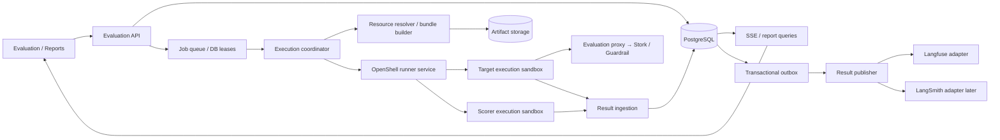

# Evaluation 模块、接口与执行设计

> 本轮数据源决策更新：按用户确认，当前 worker 直接从 Langfuse 读取 Dataset，并以 SDK experiment 反馈评分；source / library / reporter 保持平台无关接口。下文“独立后端作为数据源”和“outbox”仍为后续架构规划，不代表已实现。当前入口与限制以 docs/openshell-worker.md 为准。

本文从 AgentEval 的接入设计复制为本独立工程的规划基线。下文提到的 `web/`、旧 `src/`、现有 UI 和旧后端路径均属于原 AgentEval 工程，不是本仓库的运行依赖；本仓库当前实现范围见 README 和 roadmap。

日期：2026-10-19。状态：后端接入设计，尚未实现。以当前 Guardrail UI 和最新交互为准。

## 1. 当前实现和本设计的边界

- Web 工作台：`web/apps/control/src/features/evaluation-workbench/`。Dataset、Environment、Scorer、Evaluation、Report 都在 `WorkbenchProvider` 内存中，900ms 模拟推进；没有接入拟议 v2 API。
- Python：`src/api/routers/`、`src/sqlite_workbench.py`、`src/eval_runner.py` 已有旧评测功能。旧 Run 主要引用 agent/dataset revision，不能直接承接当前环境、多评分器和项目隔离语义。
- OpenShell：`web/apps/runner/src/index.ts` 已有 sandbox 创建、观察、删除、audit 等接口；`openshell.ts` 包装 OpenShell 操作。它服务于现有 Agent sandbox，不等于已实现 evaluation job runner。
- 可观测性：`src/backends/base.py` 已有 Tracer / TraceBackend / TraceStore，`langfuse_backend.py` 和 `local_backend.py` 是现有适配。旧链路存在“发送 trace → flush → 从平台读回 trace → 评分”，新链路不采用这个依赖顺序。
- 当前界面是 Guardrail target 列表。History 弹窗查看该 target 的历史；Trigger 配置 Dataset 版本、Environment、Scorers；默认全选可用评分器；Run 后立即进入运行中的 Report detail。非 admin 仅显示 Evaluation / Reports 菜单；这只是导航规则，服务端授权另行落实。

本次建议新增项目范围的 Evaluation 服务；首选 PostgreSQL 保存业务记录，与现有控制台共享实例但使用明确表/命名空间。大数据集、bundle、trace payload 存对象存储。旧 SQLite 继续服务旧 API，迁移前不做双写。数据库选择是本设计建议，并非现有后端已经完成迁移。

## 2. 模块、数据与接口总览

浏览器业务前缀：`/api/v2/projects/{projectId}/evaluation`。完整资源 CRUD、ETag、导入和分页细节沿用 AgentEval 原工程的 docs/evaluation/ui-integration.md（源工程参考，不是本工程运行依赖）；下表补充执行所需数据。

| 模块 | 主要数据 | 需要的接口 | 当前 UI 与后端的差距 |
|---|---|---|---|
| Target library | id、kind=GUARDRAIL、name、description、input/output schema；不可变版本；adapter 名称/版本；服务 endpointRef 或代码 artifact；credentialRef | GET `/targets?kind=GUARDRAIL`；GET `/targets/{id}/versions/{version}`；管理员创建/发布接口 | 当前只有内置 fixtures，无真实 adapter、endpoint 和发布服务 |
| Dataset | objective、fields、metadata、tags、稳定 recordId、草稿 revision；发布版本、内容 hash、记录 artifact；scorerIds 可选集合 | Dataset CRUD；草稿行 CRUD；imports preview/commit；versions 发布/查询 | 需原子导入、稳定主键、持久化及并发控制 |
| Environment | type=SANDBOX；runtime=openshell；modelId、guardrailId；并发、CPU/内存/超时；网络/路径/命令；代理路由配置 | GET/POST `/environments`；POST `/environments/{id}/versions`；GET 固定版本 | 当前 runner.id 字符串应规范为 runtime；补充镜像 digest、policy compiler 版本和服务引用 |
| Scorer library | built-in/custom、enabled；草稿；Git repo、scriptPath、threshold、notes；发布 commitSha、bundle hash、依赖锁定、入口和 ABI 版本 | Scorer CRUD、启停、发布、versions；tests 创建/查询；GET `/scorers/{id}/datasets` | 发布不能只保存 URL/path；测试必须是真实隔离任务；反查草稿及历史版本 |
| Evaluation / Trigger | target/dataset/environment/scorer 固定版本、fieldMapping、snapshot、请求幂等键、状态、运行阶段、计数、执行 attempt | POST `/evaluations`；GET `/evaluations/{id}`；POST cancel；GET events SSE | 替换前端 interval；提交后返回 id 即可跳转报告 |
| History | projectId、targetId、status、createdAt、执行次数、结果概要 | GET `/evaluations?targetId=...&status=...&cursor=...` | History 按 target 服务端过滤，不加载所有样本 |
| Report detail | evaluationId、不可变配置快照、实时计数、sample/score/error、trace tree、耗时成本、partial、delivery 状态 | GET `/reports/{evaluationId}`；GET samples；GET sample trace；GET export | 执行中即存在；断线重连后恢复进度；未完成指标明确为临时值 |
| OpenShell execution | job manifest、bundle refs、sandbox/attempt、lease、进度事件、结果 artifacts | 内部 runner job API，见第 6 节 | 需新增评测专用运行入口，不复用 UI 的 advance 模拟接口 |
| Result publishing | sink config、redaction policy、outbox、远端 ID 映射、发送重试与错误 | 管理员 sink 配置/连接检查；查询 delivery；手动重发 | 不让业务逻辑依赖 Langfuse SDK 或远端读取 |

分页统一 `{items,nextCursor}`，默认 50、上限 200。所有查询和 mutation 强制服务端 project 校验。草稿更新、导入 commit、发布使用 ETag/If-Match；已发布版本不可修改。菜单隐藏不能代替接口权限。

Dataset 的 scorerIds 表示可选评分器集合，不固定 scorer 版本；空/未配置表示不限制。Trigger 根据所选 Dataset 版本选出 enabled+published scorer，默认全选。正式启动请求必须固定实际 scorer 版本；服务端再次验证集合限制、启用状态与版本存在性。

## 3. 持久化模型

| 实体 | 必须保存的内容 |
|---|---|
| Target / TargetVersion | 项目、类型、schema、adapterRef、endpointRef/artifactRef、版本/hash；不存明文凭证 |
| Dataset / DatasetDraftRecord / DatasetVersion | 草稿 revision；稳定 recordId；发布 schema/metadata/scorerIds/records hash；记录对象地址 |
| Environment / EnvironmentVersion | 资源限制、代理配置、OpenShell/runtime 版本、镜像 digest、编译策略 hash |
| Scorer / ScorerDraft / ScorerVersion | source、enabled；repo/commit/path、运行语言、依赖锁、bundle hash、threshold |
| Evaluation | projectId、版本 refs、snapshot、状态/阶段、idempotencyKey、请求 hash、计数、错误、时间 |
| ExecutionAttempt | evaluationId、attempt、runnerJobId、sandbox refs、lease/heartbeat、fencing token、清理状态 |
| SampleResult / ScorerResult / TraceSpan | sampleId、dataset recordId、attempt；输入/输出/标准答案、各 scorer 状态/分数/理由、父子 span、token/cost |
| EvaluationEvent | evaluationId、sequence、eventId、payload；用于 SSE 回放 |
| ResultOutbox / Delivery / ExternalObjectMapping | 不可变结果事件、sink binding、发送状态、重试时间；内部对象与平台对象 ID 的映射 |

约束：`(projectId,idempotencyKey)` 唯一；同键不同请求 409。sample 的稳定业务身份是 `(evaluationId,recordId)`，attempt 独立保存；scorer 结果唯一标识包括 scorerVersion、attempt。旧 attempt 不得覆盖当前 attempt。Report 与 Evaluation 使用同一 ID；数据库是报告事实来源，平台 URL 是附加信息。

计数区分 total / targetCompleted / scoringCompleted / pass / fail / error / cancelled。只有全部选定 scorer 完成后样本才进入最终 PASS/FAIL/ERROR。运行中的 pass rate 按已完成评分样本计算并标记 provisional；ERROR 不伪装成 0 分，取消后的报告标记 partial。

## 4. 执行架构和职责



- **Evaluation API**：登录/项目授权、版本校验、快照、幂等提交、报告查询和 SSE。不执行任意脚本。
- **Coordinator**：认领任务、资源准备、调用 runner、处理重试/取消、汇总状态；不能把 HTTP 请求生命周期当作任务生命周期。
- **Resource resolver**：加载固定版本 Dataset / Target / Scorer library，解析和校验 Git commit，生成可复用 bundle。依赖构建在受限构建任务完成，不在宿主随意 pip install。
- **OpenShell runner service**：管理 sandbox 创建/就绪/exec/停止/清理，运行可信 eval worker；不把现有 Agent Instance 当成评测任务。
- **Sandbox 内 eval worker**：分派 target 调用及评分，产生规范结果。target 和 scorer 都由 library adapter 调用，返回统一契约。
- **Result ingestion**：验证 runner 身份、attempt/lease、数据 schema、顺序和去重；将结果、计数、事件和 outbox 原子写入。
- **Publisher**：脱敏、平台字段映射、批量发送、失败重试；只有它持有 Langfuse/LangSmith 凭证。

第一版每个 Evaluation 建立独立 target/scorer sandbox，按配置并发执行样本；先不做跨任务池化。虽然同属一个 runner job，target 与 scorer 的执行身份/文件/凭证必须隔离。reference 数据只给 scorer，不能放在 target 可读取的共享目录。自定义 scorer 之间也应隔离，避免读到其他评分器的凭证/输出。可信内置 scorer 可使用受控 worker 实现。

## 5. 一次 Trigger 的完整流程

1. API 接收固定版本 refs；事务内验证项目、schema/fieldMapping、Dataset scorer 限制、配额、服务引用和 sink binding，创建 QUEUED Evaluation 与 snapshot。
2. 提交返回 `202 {id,status,reportUrl}`，UI 立即进入 Report detail，通过查询 + SSE 接收后续状态；无需等待 OpenShell 就绪。
3. Coordinator 认领任务，准备 Dataset artifact、target adapter、scorer library、运行镜像与 policy。阶段 PREPARING；校验 digest/hash，解析所有可变 Git ref 为 commitSha。
4. Runner 启动 OpenShell sandbox，等待就绪，加载只读 bundle；阶段 PROVISIONING/LOADING。镜像入口使用存活 worker，单次评测由 exec 启动，避免把一次性命令退出误判为 sandbox 不健康。
5. Worker 按并发读取 sample。先只发送 input.messages 给 Guardrail target adapter，不发送 has_issue/reference。HTTP 请求经受控 Evaluation proxy；发给 Stork 的请求将 model 强制覆盖为 Environment.modelId。代理保存原 model/effective model 作为脱敏 trace attributes。Guardrail 服务由受限 endpointRef/credentialRef 解析，不能让脚本任意指定 URL 绕过。
6. target 输出规范化为 `{has_issue:boolean,decision:"BLOCK"|"ALLOW",reason:string}`，保留调用 span/耗时/错误。若目标实际 schema 不同，由 adapter 显式映射；schema 不合法返回 TARGET_OUTPUT_INVALID。
7. Scorer worker 获取 input、output、reference 和允许的 metadata，调用已加载 library 入口，生成每个 scorer 的分数/理由或独立错误。示例 Risk classification：output.has_issue 与 reference.has_issue 相同为 1，否则 0；threshold=0.8。
8. Worker 流式发送样本/评分/span 事件到 ingestion；本地 spool 未确认事件，收到 ACK 后移除。回传失败时有界缓存并背压，不无限积累。
9. ingestion 原子保存结果、更新计数、追加 SSE event 和 outbox；Report 即时显示结果，不等待 Langfuse 可查询。
10. 全部样本最终化后 Evaluation COMPLETED；基础设施失败为 FAILED；取消进入 CANCELLING 后由服务端确认 CANCELLED。保留已完成结果。释放 sandbox/临时文件/短期凭证；清理失败记录并重试。
11. Publisher 独立投递 Langfuse。发送成功与否不改变评测通过率及运行终态；Report 另显示 telemetry delivery 状态。

执行状态：`QUEUED → RUNNING → COMPLETED/FAILED`；`QUEUED/RUNNING → CANCELLING → CANCELLED`。
RUNNING.phase：PREPARING、PROVISIONING、LOADING、EXECUTING、SCORING、FINALIZING。并行流水线时 phase 只表示总体阶段，各样本另有状态。清理和平台投递状态独立，不能让报告一直停在 RUNNING。

OpenShell 客户端/网关/镜像版本需要固定并进行集成验证。仓库已有部署配置与当前官方文档版本可能不同，不能直接把 latest CLI 示例视为现有 runner 已支持的能力。

## 6. 执行相关接口与 manifest

业务启动请求沿用 `StartEvaluationV2Request`：

```json
{
  "name": "Guardrail regression",
  "target": {"id": "guardrail-privacy", "version": 2},
  "dataset": {"id": "ds-guardrail", "version": 1},
  "environment": {"id": "env-isolated", "version": 1},
  "scorers": [{"id": "sc-tone", "version": 1}],
  "fieldMapping": {"messages": "messages"},
  "metadata": {"trigger": "manual"}
}
```

结果发送目的地由项目配置解析并冻结到 snapshot，普通用户不能提交任意 collector URL。项目可配置 active sink 与凭证引用。

新增内部接口（服务身份认证，不向浏览器开放）：

| 接口 | 语义 |
|---|---|
| POST `/internal/v1/evaluation-jobs` | 提交 manifestRef + digest、project/evaluation/attempt、资源限额，幂等返回 jobId |
| GET `/internal/v1/evaluation-jobs/{id}` | sandbox 生命周期、阶段、heartbeat、错误、清理状态 |
| POST `/internal/v1/evaluation-jobs/{id}/cancel` | 幂等停止分发、终止执行、清理；返回当前状态 |
| POST `/internal/v1/evaluations/{id}/events:batch` | worker heartbeat/样本/评分/span 批量回传，校验 attempt/fencing token，返回已 ACK eventId/sequence |
| POST `/internal/v1/evaluations/{id}/artifacts:commit` | 提交已上传大结果对象的地址、大小、hash；验证项目与对象归属 |

JobManifest 至少包含：schemaVersion、projectId、evaluationId、attempt、lease token、各版本/hash、imageDigest、runtimeVersion、policyArtifact、dataset input artifact、scorer reference artifact、target/scorer bundle refs、入口、超时/并发、proxy 配置、result ingestion 配置。大数据通过限定作用域的短期 artifact 下载凭证传输；manifest 本身不放长期 secrets。

Manifest 只含 artifactRef；每个 sandbox 只能领取自身角色可见的文件。输入记录包含稳定 recordId 和 input；reference 由 scorer 单独领取。不要将包含标签的完整 CSV 挂给 target。

library ABI 建议统一 JSON，语言通过薄 wrapper 适配：

```text
TargetAdapter.invoke({sampleId,input,context})
  -> {output,usage,spans} 或结构化错误

Scorer.evaluate({sampleId,input,output,reference,metadata,context})
  -> {score: finite number in [0,1],reason:string} 或结构化错误
```

context 只放 evaluation/sample/attempt、超时、受限服务引用；不将平台密钥传入。代码 stdout 使用 JSONL 控制协议或独立结果文件，普通日志走 stderr；限制单条大小，防止代码日志污染结果协议。父 worker 捕获退出码、超时、OOM、schema 错误；评分脚本不能自行声明任意 evaluationId 写入其他任务。

## 7. 平台无关的结果发送抽象

结果生产、持久化、投递分离。Runner 不 import Langfuse/LangSmith，不调用平台 SDK；它只发送内部 EvaluationResultEvent。

```python
class ResultSink(Protocol):
    def publish(self, batch: list[ResultEnvelope]) -> list[DeliveryReceipt]: ...
    def check_connection(self) -> SinkHealth: ...

# adapters/langfuse_sink.py 先实现
# adapters/langsmith_sink.py 后续实现
# adapters/local_sink.py 用于开发/契约测试
```

ResultEnvelope（版本化内部契约）包括：

```text
schemaVersion, eventId, kind, occurredAt
projectId, evaluationId, sampleId?, recordId?, attempt, sequence
snapshotHash, targetVersion, datasetVersion, environmentVersion, scorerVersions
payload:
  trace/span: internalTraceId, spanId, parentSpanId, type, input/output,
              startedAt, endedAt, usage, cost, error, attributes
  score: resultId, scorerId, scorerVersion, spanId?, status,
         value?, reason?, threshold, passed?, error?
  summary: lifecycleStatus, counts, metrics, partial
```

kind 为 evaluation.started / span.finished / sample.finished / score.recorded / evaluation.finished 等不可变事件。发送前按项目策略脱敏/截断；精确完整结果受控保存在本地，不默认向第三方发送全量隐私数据。

| 内部概念 | Langfuse 适配 | LangSmith 适配 |
|---|---|---|
| 一次 Evaluation | 以 evaluationId/版本 metadata 关联；需要原生实验视图时由适配器建立 DatasetRun 映射 | 以 evaluationId/版本 metadata 关联；需要原生实验视图时由适配器建立 experiment/session 映射 |
| 一个 sample | 一个 trace，target/scorer 为子 observation | 一个 root run，target/scorer 为 child runs |
| ScorerResult | 对目标 trace/observation 写 Score；数值、理由和版本 metadata 映射 | 对目标 run 写 Feedback；key、score、comment 与 metadata 映射 |
| 内部 ID | 映射为平台接受的 trace/observation/score ID，保存 ExternalObjectMapping | 映射为平台接受的 run/feedback ID，保存 ExternalObjectMapping |

这是建议映射，不要求一开始同步平台原生 Dataset/Experiment。先实现 sample trace + score + evaluation metadata，即可满足发送结果；需要平台实验比较时再增加原生实验映射。

Langfuse Score 与 LangSmith Feedback 不是同一个协议；不把 traceId、runId 或供应商 SDK 类型暴露进领域模型。OTel 可用于 trace/span 传输，但评分语义、实验关联和 ID 约束仍需平台适配，不能认为换 OTLP endpoint 就完成迁移。

Outbox 与结果同事务提交。Delivery 按 sinkBindingId + eventId 唯一；发送为至少一次语义，优先使用确定性外部 ID/幂等写入，做不到远端幂等时保留去重记录并允许核对，不能承诺 exactly-once。trace/run 建立成功后再发送关联 score/feedback，评分早到时延迟队列等待映射。

Delivery 状态：PENDING → SENDING → DELIVERED / RETRY_WAIT / DEAD_LETTER；另保存 attemptCount、nextAttemptAt、externalRef、lastError。处理请求部分成功、超时后成功未知、429/5xx 指数退避及抖动、401/403 配置错误。手动重发只重发结果，绝不重新运行 target。

新增业务接口：GET `/evaluations/{id}/deliveries`；管理员 POST `/evaluations/{id}/deliveries/{deliveryId}/retry`；项目管理员 GET/PUT `/result-sinks` 和 POST `/result-sinks/{id}/check`。普通用户只看脱敏发送状态，不得读取密钥。

切换平台：新的 Evaluation 绑定新的 sinkConfigVersion；历史任务仍保留原绑定，不悄悄改目的地。需要补发历史结果时创建显式 replay job，引用本地不可变事件及新 binding；原始结果不变。可选 fan-out 到两个 sink，各自独立投递状态。

## 8. 现有代码如何接入

| 现有边界 | 改造方向 |
|---|---|
| `contracts.ts` | 保留资源 DTO；补充生命周期/phase/ERROR/scorer 独立状态、artifact refs、delivery DTO；正式调用固定版本 refs |
| `provider.tsx` | 用 API service + query cache 替换内存 fixtures/interval；保留跨子路由的任务订阅，SSE 根据 sequence 去重并补拉 snapshot |
| `domain.ts` | 保留纯校验/显示辅助；模拟函数仅用于 demo/test，不进入生产执行 |
| `src/api/routers/` | 独立 v2 项目路由和 service，复用可用校验，不能直接映射旧 agent-bound dataset |
| `src/eval_runner.py` | 提取 adapter/scorer 调用能力；移除新链路对远端 TraceStore 读回的依赖；输入为 JobManifest 和 SampleContext |
| `src/backends/base.py` | 旧 API 保持兼容；新增结果投递 ResultSink，复用 Langfuse 连接/序列化经验；不强行在旧混合读写协议上加更多方法 |
| `web/apps/runner/src/openshell.ts` | 复用 provisioning/observe/delete 底层；新增 evaluation workload profile、bundle 加载、exec、结果 channel 与 cleanup |
| `langfuse_backend.py` | 适配为 Publisher 内部实现或共享底层客户端；不要由 runner 保存平台密钥 |

## 9. 实施顺序与验收

1. **资源与契约**：持久化 Dataset/Target/Environment/Scorer 版本；Git 发布锁 commit/hash；项目鉴权、导入/发布事务及 scorer 反查。
2. **任务与本地报告**：Evaluation/Attempt/Sample/Score/Span、队列 lease、事件 ingestion、SSE；先用可控 worker 验证 UI 在 0/N、部分完成、完成、失败、取消下的行为。
3. **OpenShell 真执行**：固定运行镜像和策略，bundle 加载，Guardrail/Stork adapter，评分 library，超时/取消/清理；真实输入输出与版本快照一致。
4. **结果发送**：transactional outbox、ResultSink、Langfuse adapter、delivery UI；断开 Langfuse 不影响本地报告，恢复后补发无重复评分。
5. **LangSmith 可替换性**：先以 fake sink 通过同一契约测试，再实现 LangSmith adapter；同一批固定内部事件产生等价 score/feedback，不改 runner。

必须覆盖：跨项目 ID 拒绝；版本不可变；reference 不泄漏给 target；model override 实际生效且不可绕过；scorer 禁用阻止新任务但不破坏历史；同幂等键不重复启动；过期 lease 拒绝写入；worker 重启不会无界重复副作用；cancel 与样本晚到结果竞争；平台先后顺序/重复/部分成功；发送失败与执行失败独立；sandbox 残留可检测与回收。

对已经发出但结果未知的 Guardrail/LLM 请求，不承诺自动重试无副作用：adapter 支持 requestId 幂等时复用，否则标记执行不确定并记录 attempt，由明确策略决定是否重跑。资源构建、上传和投递可独立重试，不应因此重跑已完成 target。

## 10. 外部文档依据

- [NVIDIA OpenShell sandbox management](https://docs.nvidia.com/openshell/latest/sandboxes/manage-sandboxes.html)：创建、文件上传、exec 和生命周期；具体命令需对项目锁定版本验证。
- [NVIDIA OpenShell policies](https://docs.nvidia.com/openshell/latest/sandboxes/policies)：策略及一次性 exec 与 sandbox 健康状态的区别。
- [Langfuse Score data model](https://langfuse.com/docs/evaluation/scores/data-model)、[Scores via SDK](https://langfuse.com/docs/evaluation/evaluation-methods/scores-via-sdk)：评分与 trace/observation 等对象的关联。
- [LangSmith create_feedback](https://reference.langchain.com/python/langsmith/client/Client/create_feedback)：反馈与 run 的关联。SDK/服务版本在实施阶段固定，不在本文绑定具体调用签名。
